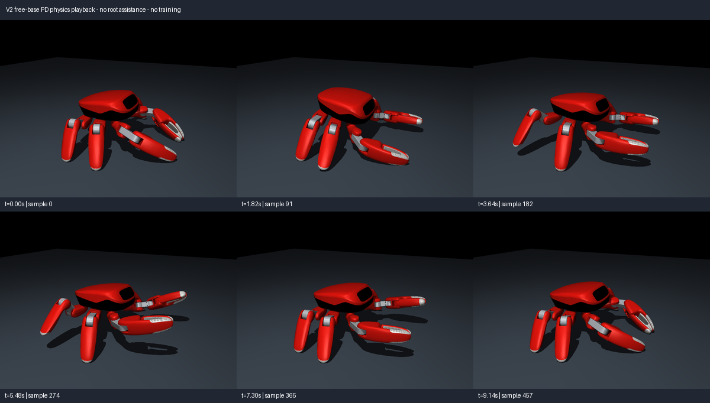

# Jumper Human Motion

**English** | [简体中文](README.zh.md)

Human-video motion retargeting and PPO imitation experiments for the 22-DoF
Jumper hexapod. This project extends
[KingKongRobotics/jumper](https://github.com/KingKongRobotics/jumper), based on
upstream commit `198686eac0d188815d0943e9fee50de415edc80a`.

The contribution is an engineering workflow connecting reviewed human motion,
robot references, task setup and traceable policy candidates. PPO, MuJoCo,
MediaPipe and the upstream mjlab/BeyondMimic tracking framework are reused.



## Extensions beyond the original repository

| Area | Upstream capability | Extension in this repository |
| --- | --- | --- |
| Motion source | Existing robot trajectories and example tasks | Reviewed video clips, 33-point human landmarks and video-derived robot references |
| Retargeting | Robot/reference infrastructure | Human arms drive LF/RF; human footsteps are adapted to LM/RM/LR/RR, with explicit crawl/kick phases |
| Amplitude review | General motion tracking | Conservative v1 and expressive v2 retained side by side; planned poses and measured PD execution are separate |
| Custom tasks | Generic PPO and tracking stack | Three independently configured `human_*` tasks with their own material, observations and tracking parameters |
| Ground consistency | Four-foot coplanarity validation | Optional near-ground support schedules for stepping/kicking, with schedule contents and tolerances included in cache fingerprints |
| Finite performance | Reference playback can wrap/reset | Explicit termination before wraparound to avoid counting a state reset as a continuous performance |
| Candidate management | Timestamped training runs | Named checkpoints under `model/`, with source paths, iteration counts and SHA-256 records |
| Reproduction | Original framework and examples | Portable preview-model paths, bilingual instructions and selected derived references/checkpoints |

This is not a new reinforcement-learning algorithm or an end-to-end system that
learns arbitrary videos automatically. Footfall order and monocular kick depth
include manual adaptation. Original upstream documentation is preserved in
[English](docs/UPSTREAM_README.md) and [Chinese](docs/UPSTREAM_README.zh.md).

## Pipeline and included material

```text
User-supplied video -> reviewed clips -> MediaPipe landmarks
  -> robot motion targets -> free-base PD records -> reference-tracking PPO
  -> measured replay and a named checkpoint candidate
```

- [v1](video/human_motion_01/v1/README.md): conservative mapping and extraction tools.
- [v2](video/human_motion_01/v2/README.md): larger stepping/kicking references.
- [model](model/README.md): named policy candidates and provenance.
- `tasks/jumper/human_*/media/`: the actual data read during training.

Raw human footage, its crops/overlays/comparison movies, downloaded pose packages,
logs and conversion caches are not included. Source hashes are retained. Supply
footage you are authorized to use to rerun extraction or human/robot comparisons;
existing robot references, robot-only previews and policy replay do not need it.
The fixed extraction intervals describe this reviewed source, not arbitrary videos.

## Install

Tested development environment: Ubuntu x86_64, Python 3.12 and RTX 5060 Laptop GPU
(8 GiB). Use a GPU-compatible PyTorch build for Warp training; see the
[upstream setup guide](docs/AGENT_SETUP.md) for GPU/CPU installation details.

```sh
git clone https://github.com/jiangsihong/jumper-human-motion.git
cd jumper-human-motion
python -m venv .venv
source .venv/bin/activate
python -m pip install -e ".[dev]"
python scripts/train.py --list
```

With an existing Conda environment, activate it and run the editable install there.
Do not install separate PyPI copies of `mjlab` or `rsl-rl-lib`; this checkout uses
its vendored code under `rl/`.

## Run a saved policy

Run one command at a time, from the repository root:

```sh
python scripts/play.py --task jumper.human_side_step --checkpoint model/side_step/side_step.pt
python scripts/play.py --task jumper.human_kick_step --checkpoint model/kick_step/kick_step.pt
python scripts/play.py --task jumper.human_arm_body_sway --checkpoint model/arm_body_sway/arm_body_sway.pt
python scripts/play.py --task jumper.tripod --checkpoint model/tripod_walk/tripod_walk.pt
```

`--task` selects the simulation/task config. `--checkpoint` selects the exact
trained network state. These commands run policy-controlled physics, not recorded
pose animation. The human candidates have 2000 training iterations; the walking
candidate has 2850. They are provided for inspection, not labeled as best policies.

## Train one motion

```sh
python scripts/train.py --task jumper.human_side_step --backend warp --device cuda:0 --num_envs 256 --max-iterations 2000 --headless
```

Replace the task with `jumper.human_kick_step` or `jumper.human_arm_body_sway` for
the other clips. Train them sequentially. 2000 iterations is an initial budget,
not a guarantee of convergence. TensorBoard is started by the existing launcher;
open its printed URL after the first event data is written.

Complete runs stay under `logs/jumper/<task>/<timestamp>/`, relative to the
launch directory. Start from the repository root. Selected copies under `model/`
are not automatically replaced by later runs. `--resume` continues the latest run;
its `--max-iterations` value means additional iterations.

## Preview a mapped reference

```sh
python video/human_motion_01/preview_mapping.py --version 1 --motion 2 --loop
python video/human_motion_01/preview_mapping.py --version 2 --motion 2 --loop
```

These are recorded reference playbacks, separate from trained-policy replay.
V2 reuses v1 landmarks and the IK utility. The third mapping uses only the first
103 full-body frames; clips 1/2 are slowed 2x and clip 3 is slowed 2.5x.
To recreate source clips, first supply the original source:

```sh
python video/human_motion_01/v1/extract_clips.py --source /path/to/source.mp4
```

Pose extraction additionally needs MediaPipe/OpenCV and the official Pose
Landmarker model under `v1/.tools/`; those optional dependencies are not vendored.
Finalizers require the matching source/clip hashes and fail clearly if unavailable;
they do not claim to have revalidated omitted footage.

## Validation and current limitations

Selected checks:

```sh
python -m pytest tests/test_registry.py tests/test_task_parity.py tests/test_reference_support.py tests/test_dance_motion.py -q
```

The selected check set recorded 51 passed and 1 skipped during development.
Publication validation including translation/layout/log-layout checks recorded
139 passed and 1 skipped; portable preview models and checkpoint hashes also passed.
Ruff 0.17.6 static checks passed across the repository.
Three added support-validation checks cover swing-vs-stance geometry, wrong
labels/timelines/heights and cache invalidation. These are software checks,
not motion success trials or stability certification.

Known limits:

- The third trained candidate still fails to reproduce the intended large
  front-arm motion. Training completion and increasing total reward do not prove
  successful imitation. The proposed reference-plus-residual controller has **not**
  been implemented.
- The v2 PD reference kick spans about 16.3 cm fore/aft and 6.1 cm vertically.
  These measurements describe a reference PD run, not the learned policy.
- Clip 3's reference tilts roughly 39 degrees. Near-ground labels are geometric
  proxies, not proof of multiple load-bearing contacts or dynamic stability.
- Actors use simulated position error and linear velocity. A real state estimator
  and deployment contract would be needed for hardware; no real-robot validation
  is claimed.
- `startup_validation.json` records early five-iteration checks. Those historical
  records are distinct from the later 2000-iteration candidates in `model/`.

## Attribution and license

The original Jumper framework, assets and notices remain attributed to KingKong
Robotics and their respective contributors. See [LICENSE](LICENSE), [NOTICE](NOTICE),
[licenses](licenses/) and [upstream provenance](docs/VENDOR.md). Upstream Apache-2.0
licensing and third-party terms are retained. User-supplied footage is not granted
an Apache license by this repository and is not redistributed here.
