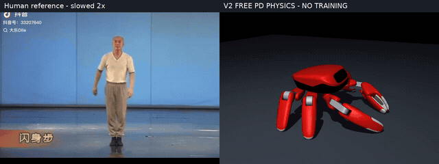
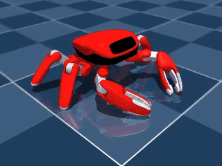
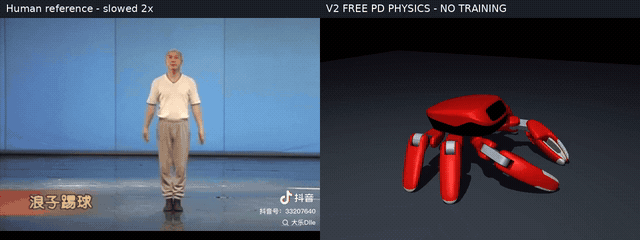
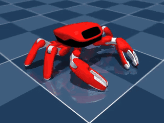
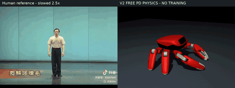
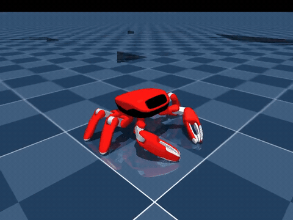

# Jumper Human Motion

**English** | [简体中文](README.zh.md)

**Teach a six-legged crab robot the human-video motions Side Step, Kick Step and Arm/Body Sway.**
Human arms drive the two front limbs, human footfalls are adapted to the other four legs,
and torso movement drives the body. The experiment connects video clips, human landmarks,
hexapod references, PPO imitation tasks and replayed policy results.

The project's main additions are:

- **Human-to-hexapod retargeting:** adapt two human legs to four stepping legs while separating arm, kick and torso roles.
- **Expressive motion revision:** preserve v1/v2, add four-leg footfall order, kick retraction/forward swing, body compensation and support schedules.
- **Three independently trainable tasks:** include references, 2000-iteration PPO checkpoints, source comparisons and newly recorded policy rollouts.

This extends [KingKongRobotics/jumper](https://github.com/KingKongRobotics/jumper), based on
upstream commit `198686eac0d188815d0943e9fee50de415edc80a`. PPO, MuJoCo, MediaPipe and
the upstream mjlab/BeyondMimic tracker are reused. The additions focus on video-to-hexapod
adaptation, task construction and inspectable experimental results.

## Watch the input, mapping and trained policies

The middle column compares the human input with the v2 free-base PD reference. The right column
shows **MuJoCo controlled by the saved 2000-iteration policy**, recorded for this showcase.
Click each GIF for its complete MP4. Columns loop independently; their playback phase is not
a frame-aligned error measurement.

| Motion | Human input → hexapod reference (PD) | Trained-policy replay (2000 iterations) |
| --- | --- | --- |
| **Side Step** | [](docs/media/human-motion/side_step_source_mapping.mp4) | [](docs/media/human-motion/side_step_policy.mp4) |
| **Kick Step** | [](docs/media/human-motion/kick_step_source_mapping.mp4) | [](docs/media/human-motion/kick_step_policy.mp4) |
| **Arm/Body Sway** | [](docs/media/human-motion/arm_body_sway_source_mapping.mp4) | [](docs/media/human-motion/arm_body_sway_policy.mp4) |

[Full input video](docs/media/human-motion/source_full.mp4) ·
[Side-step input](docs/media/human-motion/side_step_source.mp4) ·
[Kick-step input](docs/media/human-motion/kick_step_source.mp4) ·
[Actual sway input excerpt](docs/media/human-motion/arm_body_sway_source.mp4)

**Recorded training results:** all three single attempts reached the reference boundary,
producing 13.93, 9.13 and 9.47 seconds of video. Auto-reset attempts were not joined into
one continuous performance. In this kick-policy replay, the right-rear foot spans about
**119.1 mm fore/aft** and **47.4 mm vertically** in the body frame (kinematics from recorded
joints, excluding the first 0.5 s). The first two policies still differ in amplitude and pose;
the third has not learned the intended large front-arm gesture. Its actual replay is retained
for comparison; successful reproduction of all three motions has not been established.

These are existing checkpoints; **no retraining was performed**. Recordings use native CPU,
200 Hz physics, 50 Hz control, one environment and training-level observation noise. Original
training used Warp CUDA. A single simulation replay is not a success-rate study or hardware
result. See [recording commands, joint records and measurement method](docs/media/human-motion/README.md).

## Extensions beyond the original repository

| Area | Upstream capability | Extension in this repository |
| --- | --- | --- |
| Motion source | Existing robot trajectories and example tasks | Reviewed video clips, 33-point human landmarks and video-derived robot references |
| Retargeting | Robot/reference infrastructure | Human arms drive LF/RF; human footsteps are adapted to LM/RM/LR/RR, with explicit crawl/kick phases |
| Amplitude review | General motion tracking | Conservative v1 and expressive v2 retained side by side; planned poses and measured PD execution are separate |
| Custom tasks | Generic PPO and tracking stack | Three independently configured `human_*` tasks with their own material, observations and tracking parameters |
| Ground consistency | Four-foot coplanarity validation | Optional near-ground support schedules for stepping/kicking, with schedule contents and tolerances included in cache fingerprints |
| Finite performance | Reference playback can wrap/reset | Explicit termination before wraparound to avoid counting a state reset as a continuous performance |
| Candidate management | Timestamped training runs | Named checkpoints under `model/`, with source paths, iteration counts and SHA-256 records |
| Reproduction | Original framework and examples | Portable preview-model paths, bilingual instructions and selected derived references/checkpoints |

This is not a new reinforcement-learning algorithm or an end-to-end system that
learns arbitrary videos automatically. Footfall order and monocular kick depth
include manual adaptation. Original upstream documentation is preserved in
[English](docs/UPSTREAM_README.md) and [Chinese](docs/UPSTREAM_README.zh.md).

## Pipeline and included material

```text
User-supplied video -> reviewed clips -> MediaPipe landmarks
  -> robot motion targets -> free-base PD records -> reference-tracking PPO
  -> measured replay and a named checkpoint candidate
```

- [v1](video/human_motion_01/v1/README.md): conservative mapping and extraction tools.
- [v2](video/human_motion_01/v2/README.md): larger stepping/kicking references.
- [model](model/README.md): named policy candidates and provenance.
- `tasks/jumper/human_*/media/`: the actual data read during training.

At the project author's request, `docs/media/human-motion/` now includes the input video,
three used excerpts, human/reference comparisons, policy replays and joint measurements.
Historical extraction records retain source hashes. Downloaded pose packages, training logs
and conversion caches remain excluded. Clip 3 uses only the full-body interval 24.9–28.333 s.
The fixed extraction intervals describe this source, not arbitrary videos. See the
[public-media notes](video/PUBLIC_DATA.md).

## Install

Tested development environment: Ubuntu x86_64, Python 3.12 and RTX 5060 Laptop GPU
(8 GiB). Use a GPU-compatible PyTorch build for Warp training; see the
[upstream setup guide](docs/AGENT_SETUP.md) for GPU/CPU installation details.

```sh
git clone https://github.com/jiangsihong/jumper-human-motion.git
cd jumper-human-motion
python -m venv .venv
source .venv/bin/activate
python -m pip install -e ".[dev]"
python scripts/train.py --list
```

With an existing Conda environment, activate it and run the editable install there.
Do not install separate PyPI copies of `mjlab` or `rsl-rl-lib`; this checkout uses
its vendored code under `rl/`.

## Run a saved policy

Run one command at a time, from the repository root:

```sh
python scripts/play.py --task jumper.human_side_step --checkpoint model/side_step/side_step.pt
python scripts/play.py --task jumper.human_kick_step --checkpoint model/kick_step/kick_step.pt
python scripts/play.py --task jumper.human_arm_body_sway --checkpoint model/arm_body_sway/arm_body_sway.pt
python scripts/play.py --task jumper.tripod --checkpoint model/tripod_walk/tripod_walk.pt
```

`--task` selects the simulation/task config. `--checkpoint` selects the exact
trained network state. These commands run policy-controlled physics, not recorded
pose animation. The human candidates have 2000 training iterations; the walking
candidate has 2850. They are provided for inspection, not labeled as best policies.

## Train one motion

```sh
python scripts/train.py --task jumper.human_side_step --backend warp --device cuda:0 --num_envs 256 --max-iterations 2000 --headless
```

Replace the task with `jumper.human_kick_step` or `jumper.human_arm_body_sway` for
the other clips. Train them sequentially. 2000 iterations is an initial budget,
not a guarantee of convergence. TensorBoard is started by the existing launcher;
open its printed URL after the first event data is written.

Complete runs stay under `logs/jumper/<task>/<timestamp>/`, relative to the
launch directory. Start from the repository root. Selected copies under `model/`
are not automatically replaced by later runs. `--resume` continues the latest run;
its `--max-iterations` value means additional iterations.

## Preview a mapped reference

```sh
python video/human_motion_01/preview_mapping.py --version 1 --motion 2 --loop
python video/human_motion_01/preview_mapping.py --version 2 --motion 2 --loop
```

These are recorded reference playbacks, separate from trained-policy replay.
V2 reuses v1 landmarks and the IK utility. The third mapping uses only the first
103 full-body frames; clips 1/2 are slowed 2x and clip 3 is slowed 2.5x.
To recreate source clips, first supply the original source:

```sh
python video/human_motion_01/v1/extract_clips.py --source /path/to/source.mp4
```

Pose extraction additionally needs MediaPipe/OpenCV and the official Pose
Landmarker model under `v1/.tools/`; those optional dependencies are not vendored.
Finalizers require matching source/clip hashes. Pass the included
`docs/media/human-motion/source_full.mp4` to `--source` to regenerate workspace clips.

## Validation and current limitations

Selected checks:

```sh
python -m pytest tests/test_registry.py tests/test_task_parity.py tests/test_reference_support.py tests/test_dance_motion.py -q
```

The selected check set recorded 51 passed and 1 skipped during development.
Publication validation including translation/layout/log-layout checks recorded
139 passed and 1 skipped; portable preview models and checkpoint hashes also passed.
Ruff 0.17.6 static checks passed across the repository.
Three added support-validation checks cover swing-vs-stance geometry, wrong
labels/timelines/heights and cache invalidation. These are software checks,
not motion success trials or stability certification.

Known limits:

- The third trained candidate still fails to reproduce the intended large
  front-arm motion. Training completion and increasing total reward do not prove
  successful imitation. The proposed reference-plus-residual controller has **not**
  been implemented.
- The v2 PD reference kick spans about 16.3 cm fore/aft and 6.1 cm vertically.
  These measurements describe a reference PD run, not the learned policy.
- Clip 3's reference tilts roughly 39 degrees. Near-ground labels are geometric
  proxies, not proof of multiple load-bearing contacts or dynamic stability.
- Actors use simulated position error and linear velocity. A real state estimator
  and deployment contract would be needed for hardware; no real-robot validation
  is claimed.
- `startup_validation.json` records early five-iteration checks. Those historical
  records are distinct from the later 2000-iteration candidates in `model/`.

## Attribution and license

The original Jumper framework, assets and notices remain attributed to KingKong
Robotics and their respective contributors. See [LICENSE](LICENSE), [NOTICE](NOTICE),
[licenses](licenses/) and [upstream provenance](docs/VENDOR.md). Upstream Apache-2.0
licensing and third-party terms are retained. Human input footage is included as demonstration material at the project author's request,
with its visible attribution/watermark preserved. Its copyright remains with its original
rightsholders; the code license does not grant a separate license to that footage.
