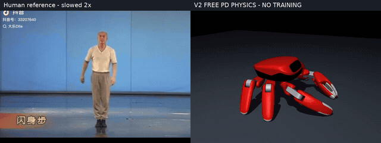
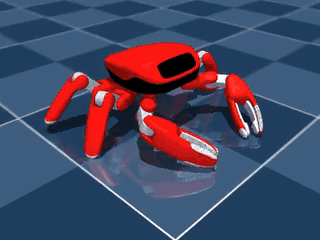
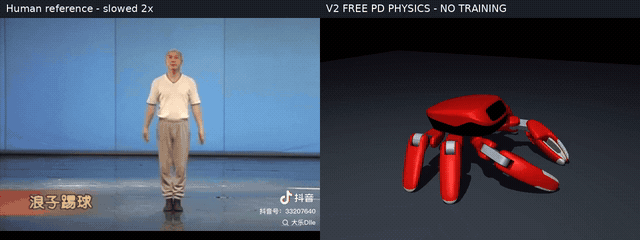
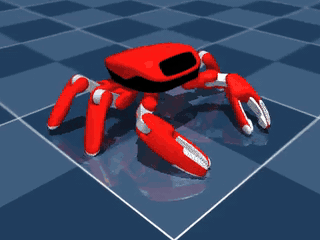
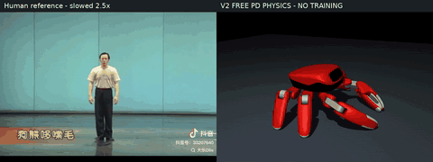
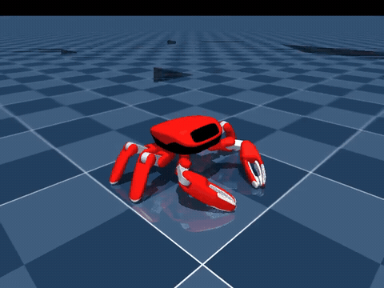

<!-- tracks: README.md @ sha256:7393f455782caaab -->

# Jumper 人体动作模仿实验

[English](README.md) | **简体中文**

**让六足螃蟹机器人模仿人物视频中的“闪身步、浪子踢球、狗熊哆嗦毛”。**
本项目把人的双臂动作映射到机器人两条前肢，把人的双脚步序改编为其余四条腿，并将身体摆动映射到机身，
形成“视频片段 → 人体关键点 → 六足动作参考 → PPO 模仿训练 → 策略回放”的完整实验流程。

本项目新增的核心工作：

- **人体到异构六足的动作映射**：解决两条人腿与四条支撑腿的数量差异，分别处理手臂、迈步、踢腿和机身。
- **从小幅动作到大幅表达**：保留 v1/v2 两版，加入四足步序、收腿与前踢阶段、机身补偿及支撑时序。
- **三个可独立训练和回放的任务**：提供参考数据、2000 轮 PPO 权重、源视频对照和本次真实策略录像。

基于 [KingKongRobotics/jumper](https://github.com/KingKongRobotics/jumper) 二次开发，比较基线为上游提交
`198686eac0d188815d0943e9fee50de415edc80a`。PPO、MuJoCo、MediaPipe 和上游 mjlab/BeyondMimic 跟踪框架为复用；
本项目的贡献集中在人体视频到六足动作的适配、任务构建和可复查的实验结果。

## 视频演示：输入、映射与训练结果

左列把人物输入与 v2 的 PD 物理参考放在一起；右列是**加载已有 2000 轮权重后，由策略控制的 MuJoCo 回放**。
点击动图可打开完整 MP4。左右两列独立循环，不能用各自动图的播放相位判断逐帧误差。

| 动作 | 人物输入 → 六足映射参考（PD） | 训练后的策略回放（2000 轮） |
| --- | --- | --- |
| **闪身步** | [](docs/media/human-motion/side_step_source_mapping.mp4) | [](docs/media/human-motion/side_step_policy.mp4) |
| **浪子踢球** | [](docs/media/human-motion/kick_step_source_mapping.mp4) | [](docs/media/human-motion/kick_step_policy.mp4) |
| **狗熊哆嗦毛** | [](docs/media/human-motion/arm_body_sway_source_mapping.mp4) | [](docs/media/human-motion/arm_body_sway_policy.mp4) |

[原始输入视频（完整）](docs/media/human-motion/source_full.mp4) ·
[闪身步输入片段](docs/media/human-motion/side_step_source.mp4) ·
[浪子踢球输入片段](docs/media/human-motion/kick_step_source.mp4) ·
[狗熊哆嗦毛实际输入片段](docs/media/human-motion/arm_body_sway_source.mp4)

**本次训练结果展示：**三个已训练策略的单次尝试均运行到参考片尾，分别记录 13.93、9.13、9.47 秒视频；
没有把自动重置后的新尝试拼接成连续表演。浪子踢球策略的右后腿在本次回放中前后行程约 **119.1 毫米**、
上下约 **47.4 毫米**（机身相对运动学测量，排除前 0.5 秒）。前两个动作仍有幅度及姿态误差；
第三个动作未学好大幅摆臂，保留其真实录像以便比较，尚不能称三个动作都成功复现。

本次仅回放已有权重，**没有重新训练**。录像使用 native CPU 后端，200 Hz 物理、50 Hz 控制、单环境、
训练观察噪声开启；原训练使用 Warp CUDA。它展示单次仿真执行，不代表多次成功率或真机效果。
[录像命令、原始关节记录及测量方法](docs/media/human-motion/README.zh.md)可用于复查。

## 相对原仓库的创新与工程扩展

| 方面 | 原仓库已有能力 | 本项目新增内容 |
| --- | --- | --- |
| 动作来源 | 机器人轨迹和示例任务 | 人工审核的视频片段、33 点人体关键点和视频动作参考生成 |
| 人体到机器人映射 | 机器人与参考轨迹基础设施 | 双臂对应 LF/RF，脚步改编为 LM/RM/LR/RR 四腿步序，并明确踢腿阶段 |
| 幅度检查 | 通用动作跟踪 | 并排保留保守版 v1、大幅度版 v2，分别记录计划姿态与实际 PD 物理执行 |
| 自定义任务 | 通用 PPO 和跟踪框架 | 三个独立的 human_* 任务，各自保存素材、观察输入和跟踪参数 |
| 地面一致性 | 四足共面检查 | 为迈步、踢腿增加可选近地支撑时序，标签和阈值参与缓存校验 |
| 有限动作结束 | 参考动作可循环并重置 | 在片尾自动跳回之前结束，避免把状态重置误认为连续完成动作 |
| 模型管理 | 按时间保存训练记录 | model/ 下按动作命名，记录来源、训练轮数和 SHA-256 |
| 可复现使用 | 原框架和示例 | 预览模型使用可移植路径，中英文说明及选定动作数据、权重随仓库提供 |

这些是工程流程和任务扩展，不是新发明 PPO，也不是任意视频端到端自动模仿。四足步序和单目踢腿深度包含人工适配。
原仓库说明保留为[英文版](docs/UPSTREAM_README.md)和[中文版](docs/UPSTREAM_README.zh.md)。

## 工作流程与公开内容

```text
用户自备视频 → 人工审核片段 → MediaPipe 人体关键点
  → 机器人目标轨迹 → 无额外机身支撑的 PD 物理记录
  → PPO 参考动作跟踪 → 测量回放 → 按动作命名的候选权重
```

- [v1](video/human_motion_01/v1/README.zh.md)：保守映射和最初的提取工具。
- [v2](video/human_motion_01/v2/README.zh.md)：大幅度迈步、踢腿参考。
- [model](model/README.zh.md)：按动作名称查找模型和来源。
- `tasks/jumper/human_*/media/`：训练真正读取的动作数据。

本次按项目作者要求，在 `docs/media/human-motion/` 发布输入视频、实际使用的三个片段、人物与参考对照、策略回放和关节测量。
历史提取工作区仍保留源校验记录；下载的姿态依赖、训练日志和转换缓存不打包。第三段只使用 24.9–28.333 秒全身可见片段。
提取脚本中的固定时间段针对本次素材，不适用于任意视频。详见[公开素材说明](video/PUBLIC_DATA.zh.md)。

## 安装

开发时使用 Ubuntu x86_64、Python 3.12、RTX 5060 Laptop GPU（8 GiB）。GPU 训练需要兼容的 PyTorch CUDA 构建；
GPU/CPU 安装细节见[原项目环境指南](docs/AGENT_SETUP.md)。

```sh
git clone https://github.com/jiangsihong/jumper-human-motion.git
cd jumper-human-motion
python -m venv .venv
source .venv/bin/activate
python -m pip install -e ".[dev]"
python scripts/train.py --list
```

已有 Conda 环境时，激活后执行可编辑安装即可。不要另外安装 PyPI 的 mjlab 或 rsl-rl-lib，本工程使用 rl/ 下的仓库内版本。

## 运行已保存的策略

在工程根目录一次运行一条：

```sh
python scripts/play.py --task jumper.human_side_step --checkpoint model/side_step/side_step.pt
python scripts/play.py --task jumper.human_kick_step --checkpoint model/kick_step/kick_step.pt
python scripts/play.py --task jumper.human_arm_body_sway --checkpoint model/arm_body_sway/arm_body_sway.pt
python scripts/play.py --task jumper.tripod --checkpoint model/tripod_walk/tripod_walk.pt
```

--task 选择任务及仿真配置，--checkpoint 指定训练网络。这里由策略实时控制物理仿真，不是播放保存的姿态。
三个视频动作是 2000 轮候选，行走是 2850 轮候选，用于检查，不宣称是最佳模型。

## 训练单个动作

```sh
python scripts/train.py --task jumper.human_side_step --backend warp --device cuda:0 --num_envs 256 --max-iterations 2000 --headless
```

把任务名改成 jumper.human_kick_step 或 jumper.human_arm_body_sway 可训练另外两段。建议依次训练。
2000 轮是初始预算，不保证学会。TensorBoard 由原入口启动，第一批数据写入后打开终端打印的网址。

完整记录按启动目录保存到 logs/jumper/任务名/时间戳/，所以建议从工程根目录运行。
后续训练不会自动替换 model/ 中的选定副本。--resume 继续最新记录，此时 --max-iterations 表示再训练多少轮。

## 查看映射参考

```sh
python video/human_motion_01/preview_mapping.py --version 1 --motion 2 --loop
python video/human_motion_01/preview_mapping.py --version 2 --motion 2 --loop
```

这里是记录好的参考回放，与已训练策略回放分开。第二版复用第一版的人体关键点和逆运动学工具。
第三段只用了最初 103 帧全身可见片段；第一、二段放慢为原速度的 1/2，第三段为 1/2.5。
重新裁剪前先提供原素材：

```sh
python video/human_motion_01/v1/extract_clips.py --source /path/to/source.mp4
```

人体提取还需要 MediaPipe、OpenCV 和 v1/.tools/ 下的官方 Pose Landmarker 模型，这些可选依赖不打包进仓库。
最终检查脚本要求源视频和片段的校验值匹配。可向 `--source` 指定本仓库 `docs/media/human-motion/source_full.mp4`，重新生成工作区片段。

## 验证与当前限制

选定检查命令：

```sh
python -m pytest tests/test_registry.py tests/test_task_parity.py tests/test_reference_support.py tests/test_dance_motion.py -q
```

开发时这组检查记录为 51 项通过、1 项跳过。发布前连同翻译、目录布局和日志布局的检查共 139 项通过、1 项跳过；可移植预览模型及权重校验值检查也通过，Ruff 0.17.6 全仓静态检查通过。新增的三个支撑检查覆盖摆腿与支撑脚的几何区别、错误标签/时间/高度、缓存失效。
这些是软件检查，不是动作成功率试验或稳定性认证。

目前限制：

- 第三段训练候选仍未学好大幅摆臂。训练完成或总奖励上涨，不代表成功模仿；此前提出的“参考动作加有限修正”控制器尚未实施。
- 第二版参考 PD 回放的踢腿前后行程约 16.3 厘米、上下约 6.1 厘米，这不是已学习策略的成绩。
- 第三段参考约有 39 度机身倾斜。近地标签不证明真实承重接触数量或动态稳定性。
- 策略读取仿真位置误差和线速度；真机需要状态估计及部署接口，本项目没有真机验证结果。
- startup_validation.json 是早期五轮启动记录，与之后 model/ 中的 2000 轮候选区分。

## 来源与许可证

原 Jumper 框架、资产和声明保留 KingKong Robotics 及各贡献者署名。
见 [LICENSE](LICENSE)、[NOTICE](NOTICE)、[licenses](licenses/) 与[第三方代码来源](docs/VENDOR.md)。
保留原 Apache-2.0 和第三方许可条款。人物输入视频按项目作者要求作为演示素材附上，保留原画面署名/水印；
原视频版权归原权利人，仓库代码许可证不为该视频另行授予许可。
